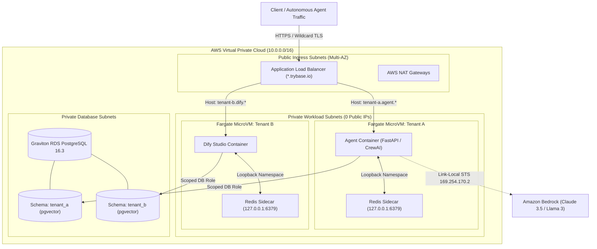

# Architecture Topology

TryBase is structured around a multi-tier hyperscaler architecture designed for high-density, multi-tenant AI workloads with strict cryptographic boundaries.

---

## High-Level Topology



---

## VPC & Network Boundaries

Security begins at the packet layer. TryBase isolates all compute from direct public internet exposure:

### 1. Dual-Tier Subnet Hierarchy
* **Public Ingress Tier (`10.0.1.0/24`, `10.0.2.0/24`)**: Contains only the Application Load Balancer and managed AWS NAT Gateways. No application containers or databases reside here.
* **Private Workload Tier (`10.0.10.0/24`, `10.0.20.0/24`)**: Houses all ECS Fargate tasks. Instances in this tier receive **zero public IP addresses** (`assign_public_ip = false`).
* **Private Database Tier (`10.0.30.0/24`, `10.0.40.0/24`)**: Houses the Graviton RDS database with restricted security group ingress accepting connections exclusively from the workload security group on TCP port `5432`.

### 2. Outbound Egress & NAT
Workloads communicate with external third-party APIs (such as OpenAI, Tavily, or Slack webhooks) through the AWS NAT Gateway. Inbound unsolicited traffic from the internet is physically dropped at the subnet boundary.

---

## Fargate Graviton MicroVMs

TryBase runs agent tasks on **AWS Fargate with AWS Graviton (ARM64)** processors:

* **Hardware-Level Hypervisor Isolation**: Each task runs in a dedicated Firecracker MicroVM. Unlike standard Docker daemon multi-tenancy where containers share the host Linux kernel, Firecracker provides dedicated virtual hardware, memory, and CPU registers.
* **Graviton FinOps Efficiency**: Graviton processors deliver up to 40% better price-performance compared to comparable x86_64 instances for Python and JavaScript runtimes.
* **Independent Scalability**: Each agent workload is configured with its own CPU and memory allocation (e.g. `256 vCPU / 512 MiB RAM` up to `4096 vCPU / 16384 MiB RAM`), scaling up and down independently.

---

## Traffic Ingress & Routing

TryBase utilizes a single shared Application Load Balancer (ALB) to route traffic to hundreds of isolated workloads without provisioning expensive per-tenant load balancers.

### 1. Wildcard TLS Termination
An AWS Certificate Manager (ACM) wildcard certificate (`*.trybase.yourdomain.com`) terminates SSL/TLS at the edge. HTTPS traffic is decrypted, inspected, and forwarded over private VPC subnets.

### 2. Host-Header Rule Evaluation
When an agent workload is provisioned, Step Functions attaches an ALB Listener Rule that matches the tenant's fully qualified domain:

```hcl
resource "aws_lb_listener_rule" "tenant_routing" {
  listener_arn = aws_lb_listener.https.arn
  priority     = var.alb_listener_rule_priority

  action {
    type             = "forward"
    target_group_arn = aws_lb_target_group.workload.arn
  }

  condition {
    host_header {
      values = ["${var.tenant_id}.${var.workload_domain}"]
    }
  }
}
```

This architecture provides sub-millisecond layer 7 routing directly to the target MicroVM.

---

## Vector Memory Subsystem

Autonomous agents require long-term associative memory for RAG, contextual recall, and session management.

### 1. RDS PostgreSQL 16.3 with pgvector
TryBase provisions a multi-AZ AWS Graviton RDS PostgreSQL 16.3 instance with the native `pgvector 0.7.0` extension pre-installed.

### 2. Isolated Tenant Schemas
Rather than maintaining an expensive vector database cluster per tenant, TryBase uses PostgreSQL schemas:
* Each workload receives an isolated schema: `CREATE SCHEMA tenant_slug;`
* Vector tables are created with HNSW (Hierarchical Navigable Small World) indexes:
  ```sql
  CREATE INDEX ON tenant_slug.embeddings USING hnsw (embedding vector_cosine_ops);
  ```
* Queries against 1,536-dimensional OpenAI or Titan embeddings return in under **5 milliseconds**.

---

## In-Task Redis Sidecar

Many modern agent frameworks (such as Dify for Celery worker queues or LangChain for memory buffers) require Redis. Traditional cloud setups deploy a shared AWS ElastiCache cluster, which adds ~$20-$40/month of standing idle costs and introduces cross-tenant cache collision risks.

### The Sidecar Solution
TryBase runs Redis as a lightweight sidecar container inside the tenant's Fargate task definition:

```json
[
  {
    "name": "application",
    "image": "ghcr.io/trybase/agent:latest",
    "essential": true,
    "environment": [
      { "name": "REDIS_HOST", "value": "127.0.0.1" },
      { "name": "REDIS_PORT", "value": "6379" }
    ]
  },
  {
    "name": "redis-sidecar",
    "image": "redis:7-alpine",
    "essential": true,
    "memoryReservation": 128
  }
]
```

### Architectural Benefits
1. **Zero Standing Cost**: Redis runs inside the container's allocated memory. No ElastiCache cluster fees, no VPC peering costs.
2. **0.05ms Latency**: Because both containers share the same `awsvpc` network namespace, traffic travels over the local loopback (`127.0.0.1`), eliminating all network hops.
3. **Physical Cache Isolation**: Tenant A's Redis cache cannot be accessed or corrupted by Tenant B.

---

## Next Steps

* [Learn about Security & Zero-Static Secrets](./security.md)
* [Review Workload Adapter Specifications](./workload-adapters.md)
* [Inspect FinOps Pre-Deploy Auditing](./finops.md)
