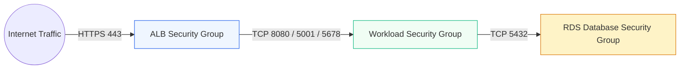

# Private VPC & Network Boundaries

> [!IMPORTANT]
> In TryBase, compute microVMs and databases receive zero public IP addresses. Inbound traffic cannot reach containers directly from the internet under any circumstances.

---

## 1. Subnet CIDR Architecture

The TryBase network is organized across two Availability Zones for high availability:

| Tier | Subnet AZ 1 | Subnet AZ 2 | Route Table Route | Direct Public IP? |
| :--- | :--- | :--- | :--- | :--- |
| **Public Ingress Tier** | `10.0.1.0/24` | `10.0.2.0/24` | Internet Gateway (`0.0.0.0/0 -> igw`) | Yes (ALB & NAT only) |
| **Private Workload Tier** | `10.0.10.0/24` | `10.0.20.0/24` | NAT Gateway (`0.0.0.0/0 -> nat`) | **NO (0 Public IPs)** |
| **Private Database Tier** | `10.0.30.0/24` | `10.0.40.0/24` | Isolated (Local VPC only) | **NO (0 Public IPs)** |

---

## 2. Security Group Matrix

Network boundaries are enforced at the AWS hypervisor layer using security groups:



### Ingress & Egress Rules
1. **ALB Security Group**:
   * Inbound: `0.0.0.0/0` on TCP `443` (HTTPS) and `80` (redirect to HTTPS).
   * Outbound: To `SG_Workload` on application ports (`8080`, `5001`, `5678`).
2. **Workload Security Group**:
   * Inbound: Restricted exclusively to `SG_ALB` on application ports. All other inbound traffic is dropped.
   * Outbound: `0.0.0.0/0` on `443` via NAT Gateway for external API calls, and to `SG_RDS` on port `5432`.
3. **RDS Database Security Group**:
   * Inbound: Restricted exclusively to `SG_Workload` on TCP port `5432`.
   * Outbound: None (isolated database subnet).

---

## 3. Zero Public IP Invariant

When ECS Fargate tasks are launched, the network configuration strictly disables public IP assignment:

```hcl
network_configuration {
  subnets          = [aws_subnet.private_1.id, aws_subnet.private_2.id]
  security_groups  = [aws_security_group.workload.id]
  assign_public_ip = false
}
```

This ensures that port-scanners, Shodan indexers, and automated botnets cannot discover or reach the microVM.

---

[Next: Fargate Graviton MicroVMs →](./fargate-microvms.md)
