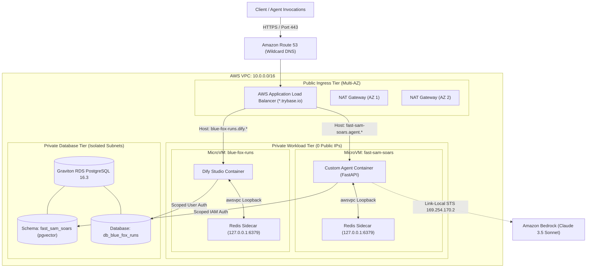

# Hyperscaler Topology

> [!NOTE]
> TryBase organizes cloud infrastructure into three isolated tiers: Public Edge Ingress, Private Compute Fleet, and Scoped Vector Data.

---

## 1. End-to-End Architectural Diagram

---

## 2. Infrastructure Flow Breakdown

### 1. Ingress Request Journey
1. Inbound HTTPS traffic reaches the **Application Load Balancer** on TCP port 443.
2. The wildcard ACM certificate (`*.trybase.yourdomain.com`) terminates TLS.
3. The ALB evaluates host-header listener rules (e.g. `fast-sam-soars.agent.trybase.yourdomain.com`).
4. Traffic is forwarded over private subnets directly to the target Fargate task's private IP.

### 2. Compute Execution
1. The container runs on an **AWS Fargate Graviton ARM64 MicroVM**.
2. Outbound internet access (for webhooks or LLM APIs) routes through the **AWS NAT Gateway**.
3. Internal cache calls communicate with the local **Redis sidecar** over `127.0.0.1:6379` at 0.05ms latency.

### 3. Data & LLM Invocations
1. Foundation model inferences (Claude 3.5, Titan, Llama 3) invoke **Amazon Bedrock** keylessly via the link-local STS endpoint (`169.254.170.2`).
2. Vector embeddings and conversation history are read and written to **PostgreSQL 16.3 with pgvector 0.7** using dedicated tenant schemas.

---

[Next: Private VPC & Network Boundaries →](./networking.md)
