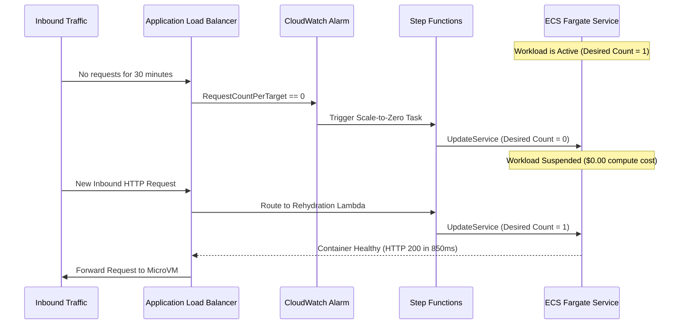

# Scale-to-Zero Architecture

> [!NOTE]
> Autonomous agents that execute periodic automations, webhooks, or batch tasks waste compute while standing idle. TryBase supports automated scale-to-zero.

---

## 1. The Scale-to-Zero Lifecycle

---

## 2. Rehydration Performance

Because AWS Fargate with Graviton uses **Firecracker MicroVMs**, cold start times are drastically lower than standard EC2 instances:

| Metric | Legacy EC2 Node Boot | Fargate Firecracker MicroVM |
| :--- | :--- | :--- |
| **Kernel Boot Time** | ~45 - 90 seconds | **< 1.2 seconds** |
| **Container Initialization** | ~15 - 30 seconds | **~2.5 seconds** |
| **Health Check Ready** | ~60 - 120 seconds | **< 4.5 seconds** |

---

[Next: Provisioning REST API →](../control-plane/api.md)
