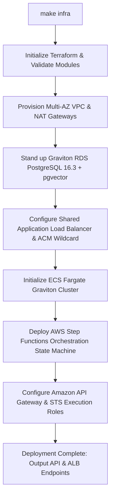

# Fleet Deployment

> [!NOTE]
> Deploying the complete TryBase fleet takes approximately **6 to 8 minutes**. All infrastructure is orchestrated via declarative Terraform and automated Make targets.

---

## 1. Remote State Bootstrap

Before applying infrastructure, create an isolated S3 bucket for Terraform remote state and a DynamoDB table for distributed state locking:

```bash
make bootstrap
```

This ensures that team members cannot execute concurrent conflicting deployments.

---

## 2. One-Command Fleet Deployment

> [!IMPORTANT]
> Ensure you have configured your `base_domain` and wildcard `acm_certificate_arn` in `terraform/terraform.tfvars` before deploying. See the [ACM Wildcard SSL Certificate Guide](./configuration.md#2-generating-an-aws-acm-wildcard-ssl-certificate) for step-by-step instructions.

Execute the automated fleet deployment:

```bash
make infra
```

This target runs `deploy-infra.sh`, executing the following pipeline:



### Deployment Output

Upon completion, Terraform outputs your core infrastructure endpoints:

```text
Apply complete! Resources: 182 added, 0 changed, 0 destroyed.

Outputs:

alb_dns_name            = "trybase-alb-123456789.eu-west-2.elb.amazonaws.com"
api_gateway_url         = "https://api.trybase.yourdomain.com/v1"
ecs_cluster_name        = "trybase-production-cluster"
rds_endpoint            = "trybase-db.c123456789.eu-west-2.rds.amazonaws.com:5432"
step_function_arn       = "arn:aws:states:eu-west-2:656876168893:stateMachine:trybase-orchestrator"
wildcard_certificate_arn = "arn:aws:acm:eu-west-2:656876168893:certificate/a1b2c3d4-..."
```

---

## 3. Control Plane Initialization

Once the AWS infrastructure is active, apply database migrations and deploy Edge orchestration functions:

```bash
make control-plane
```

This target:
1. Applies the `workspaces` table schema to your Supabase PostgreSQL instance.
2. Enables Row-Level Security (RLS) policies.
3. Configures Realtime event broadcasting for instant UI state synchronization.

---

[Next: Quickstart: Deploy First Workload →](./quickstart.md)
