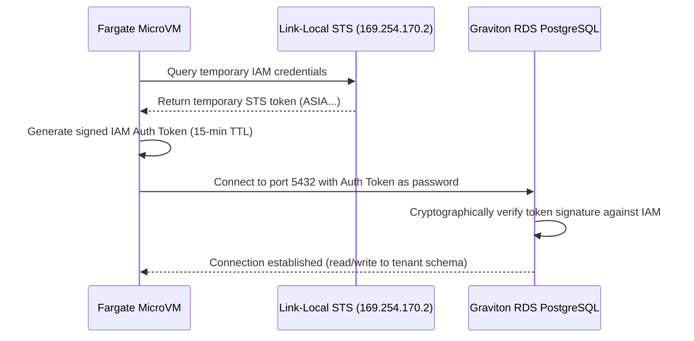

# Security Standard & Zero-Trust IAM

TryBase was designed under the assumption that application-level vulnerabilities will occur. The security model ensures that even in the event of arbitrary remote code execution (RCE) or supply-chain corruption within an agent container, the blast radius is strictly contained.

---

## The Anti-Leak Standard

### Lessons from Industry Breaches
In high-profile platform security incidents (such as the 2026 Railway breach), attackers gained access through vulnerable edge components and dumped environment variables or configuration stores containing static credentials:
* AWS IAM Access Keys (`AKIA...`)
* Permanent database master passwords
* Third-party foundation model API keys

Because these keys were long-lived and broad in scope, the breach cascaded across the entire platform.

### TryBase Invariant: Zero Static Secrets
In TryBase, **zero static AWS credentials or master passwords are ever passed into container environment variables**. If an attacker executes `env`, inspects `/proc/1/environ`, or runs an arbitrary shell command, they will find no AWS keys.

---

## Keyless STS Authentication

Workloads interact with AWS services (such as Amazon Bedrock, S3, or DynamoDB) using short-lived tokens minted by the AWS Security Token Service (STS).

### The Link-Local Metadata Agent (`169.254.170.2`)
AWS Fargate exposes a link-local metadata endpoint reachable exclusively from within that specific MicroVM:

```text
http://169.254.170.2$AWS_CONTAINER_CREDENTIALS_RELATIVE_URI
```

```
┌────────────────────────────────────────────────────────────────┐
│  Fargate MicroVM Container                                     │
│                                                                │
│  1. Agent code initializes SDK (boto3 / @aws-sdk)              │
│  2. SDK queries http://169.254.170.2/credentials               │
│  3. AWS STS returns temporary ASIA... token (valid 60 min)     │
│  4. SDK silently refreshes token in-memory before expiry       │
└────────────────────────────────────────────────────────────────┘
```

### The 60-Minute Rotation Cycle
1. **SDK Query**: The application SDK detects no local environment credentials and queries `169.254.170.2`.
2. **STS Minting**: STS assumes the container's dedicated Task Role and issues temporary credentials starting with `ASIA...`.
3. **Silent Refresh**: 10–15 minutes prior to expiration, the SDK automatically refreshes the token in memory.
4. **Zero Disruption**: The application never restarts, reconnects, or encounters auth expiration.

If an attacker dumps the in-memory token, it is cryptographically bound to that microVM and expires within minutes.

---

## Unix Domain Sockets with Linux `SO_PEERCRED`

When deploying local background sidecars (such as monitoring agents, vector sync daemons, or MCP sidecars), standard architectures open a localhost TCP port (e.g. `127.0.0.1:9000`).

### The TCP Port Vulnerability
In containerized environments, any process running inside the network namespace—including an attacker who achieves RCE in a web framework—can connect to `127.0.0.1:9000` and execute privileged commands without authentication.

### The Kernel-Enforced Socket Solution
TryBase sidecar daemons communicate over **Unix Domain Sockets** using the Linux `SO_PEERCRED` socket option:

```c
// Sidecar daemon verifies caller credentials via kernel
struct ucred cred;
socklen_t len = sizeof(struct ucred);
getsockopt(client_fd, SOL_SOCKET, SO_PEERCRED, &cred, &len);

if (cred.uid != 1000) {
    // Drop connection immediately; caller is untrusted
    close(client_fd);
}
```

### Benefits of `SO_PEERCRED`
* **No Open TCP Port**: The daemon does not bind to any network port, closing off internal port-scanning.
* **Kernel-Enforced Identity**: The Linux kernel directly supplies the caller's process UID, GID, and PID. This metadata cannot be spoofed by user-space code.
* **Filesystem Permissions**: The socket file itself is protected with standard Linux POSIX permissions (e.g. `0600`), restricting access before connection establishment.

---

## Passwordless RDS IAM Authentication

Application containers must never receive the PostgreSQL master password. Instead, TryBase leverages AWS IAM Database Authentication:



1. The container generates an auth token signed with its IAM Task Role.
2. The token is passed as the password when connecting to PostgreSQL.
3. The token expires in **15 minutes** and cannot be used by unauthorized entities.

---

## Per-Tenant IAM Isolation

Every workload provisioned by TryBase receives a unique, dedicated IAM Task Role:

```hcl
resource "aws_iam_role" "task_role" {
  name = "trybase-${var.tenant_id}-task-role"

  assume_role_policy = jsonencode({
    Version = "2012-10-17"
    Statement = [{
      Action    = "sts:AssumeRole"
      Effect    = "Allow"
      Principal = { Service = "ecs-tasks.amazonaws.com" }
    }]
  })
}
```

### Isolation Guarantees
* **Zero Cross-Talk**: Tenant A's task role physically lacks permissions to access Tenant B's S3 buckets, Bedrock models, or database schemas.
* **Granular Audit Trails**: Every API call executed by an agent is logged in AWS CloudTrail under the specific tenant's IAM Role ARN (`arn:aws:iam::...:role/trybase-tenant-a-task-role`), providing non-repudiable audit logs.

---

## Next Steps

* [Explore the Workload Adapter Specification](./workload-adapters.md)
* [Review Infrastructure FinOps & Governance](./finops.md)
* [Inspect the Provisioning API Reference](./api-reference.md)
