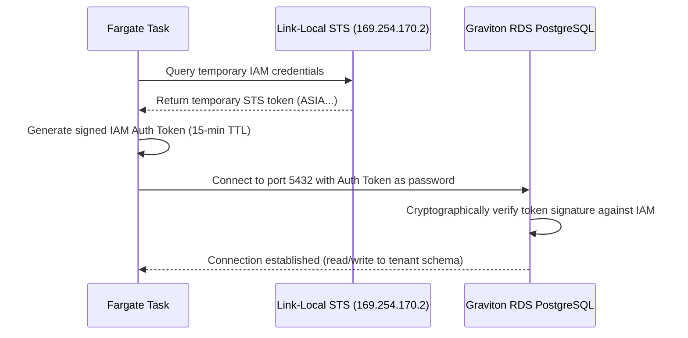

# Security Standard & Zero-Trust IAM

TryBase was designed under the assumption that application-level vulnerabilities will occur. The security model ensures that even in the event of arbitrary command execution or supply-chain corruption within an application container, exposure of cloud and infrastructure secrets is strictly minimized.

---

## TryBase v1 Security Scope & Threat Model

### TryBase v1 security scope

TryBase delivers configured secrets over a Unix-domain socket into application memory, avoiding the need to store those secrets in production .env files or inject them into process environment variables.

This reduces exposure through secret-file disclosure, environment dumps and automatic environment inheritance by child processes. The daemon applies implemented peer-verification rules before returning secrets.

These controls do not establish that an authorised interpreter is executing trusted application code. Malicious code running inside the authorised application may access delivered secrets and exercise the application’s permissions. Secrets may also leak through application logging, debugging or configuration caching unless those paths are controlled.

Tenant containment depends on correctly configured database permissions, IAM policies and workload isolation. Shared database infrastructure retains shared resource and availability risks.

Host/kernel compromise and privileged process inspection are outside this mechanism’s protection.

---

## Keyless STS Authentication

Workloads interact with AWS services (such as Amazon Bedrock, S3, or DynamoDB) using temporary credentials minted by the AWS Security Token Service (STS).

### The Link-Local Metadata Agent (`169.254.170.2`)
AWS Fargate exposes a link-local metadata endpoint reachable from within that task:

```text
http://169.254.170.2$AWS_CONTAINER_CREDENTIALS_RELATIVE_URI
```

```
┌────────────────────────────────────────────────────────────────┐
│  Fargate Task Container                                        │
│                                                                │
│  1. Application code initializes SDK (boto3 / @aws-sdk)        │
│  2. SDK queries http://169.254.170.2/credentials               │
│  3. AWS STS returns temporary ASIA... credentials              │
│  4. SDK automatically refreshes credentials prior to expiry    │
└────────────────────────────────────────────────────────────────┘
```

### Temporary Credential Refresh Cycle
1. **SDK Query**: The application SDK detects no local environment credentials and queries `169.254.170.2`.
2. **STS Minting**: STS assumes the container's dedicated Task Role and issues temporary credentials starting with `ASIA...`.
3. **Automatic Refresh**: Prior to expiration, the SDK automatically refreshes credentials in memory.
4. **Task Scoping**: The temporary credentials are bound to that specific task's IAM role.

---

## Unix Domain Sockets with Linux `SO_PEERCRED`

When deploying local background sidecars (such as monitoring agents, vector sync daemons, or MCP sidecars), standard architectures open a localhost TCP port (e.g. `127.0.0.1:9000`).

### The TCP Port Vulnerability
In containerized environments, any process running inside the network namespace—including an attacker who achieves RCE in a web framework—can connect to `127.0.0.1:9000` and execute privileged commands without authentication.

### The Kernel-Enforced Socket Solution
TryBase sidecar daemons communicate over **Unix Domain Sockets** using the Linux `SO_PEERCRED` socket option:

```c
// Sidecar daemon verifies caller credentials via kernel
struct ucred cred;
socklen_t len = sizeof(struct ucred);
getsockopt(client_fd, SOL_SOCKET, SO_PEERCRED, &cred, &len);

if (cred.uid != 1000) {
    // Drop connection immediately; caller is untrusted
    close(client_fd);
}
```

### Benefits of `SO_PEERCRED`
* **No Open TCP Port**: The daemon does not bind to any network port, closing off internal port-scanning.
* **Kernel-Enforced Identity**: The Linux kernel directly supplies the caller's process UID, GID, and PID. This metadata cannot be spoofed by user-space code.
* **Filesystem Permissions**: The socket file itself is protected with standard Linux POSIX permissions (e.g. `0600`), restricting access before connection establishment.

---

## Passwordless RDS IAM Authentication

Application containers must never receive the PostgreSQL master password. Instead, TryBase leverages AWS IAM Database Authentication:



1. The container generates an auth token signed with its IAM Task Role.
2. The token is passed as the password when establishing a connection to PostgreSQL.
3. The token serves as an ephemeral connection-handshake credential (valid for 15 minutes to establish a connection). Active database connections remain open after connection establishment; long-running application workers must regenerate a fresh token when reconnecting after pool drops.

---

## Per-Tenant IAM Isolation

Every workload provisioned by TryBase receives a unique, dedicated IAM Task Role:

```hcl
resource "aws_iam_role" "task_role" {
  name = "trybase-${var.tenant_id}-task-role"

  assume_role_policy = jsonencode({
    Version = "2012-10-17"
    Statement = [{
      Action    = "sts:AssumeRole"
      Effect    = "Allow"
      Principal = { Service = "ecs-tasks.amazonaws.com" }
    }]
  })
}
```

### Isolation Guarantees
* **Zero Cross-Talk**: Tenant A's task role physically lacks permissions to access Tenant B's S3 buckets, Bedrock models, or database schemas.
* **Granular Audit Trails**: Every API call executed by an agent is logged in AWS CloudTrail under the specific tenant's IAM Role ARN (`arn:aws:iam::...:role/trybase-tenant-a-task-role`), providing non-repudiable audit logs.

---

## Next Steps

* [Explore the Workload Adapter Specification](./workload-adapters.md)
* [Review Infrastructure FinOps & Governance](./finops.md)
* [Inspect the Provisioning API Reference](./api-reference.md)
