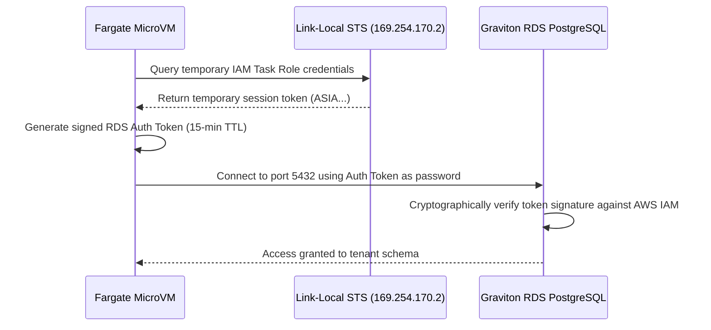

# Passwordless RDS IAM Authentication

> [!NOTE]
> Application containers in TryBase never receive the PostgreSQL master password. Database connections are authenticated using short-lived IAM Database Authentication tokens.

---

## 1. The Passwordless Authentication Flow



---

## 2. Generating Connection Tokens (Python)

```python
import os
import boto3
import psycopg2

rds_client = boto3.client("rds", region_name="eu-west-2")

# Generate signed IAM authentication token valid for 15 minutes
auth_token = rds_client.generate_db_auth_token(
    DBHostname=os.environ["DB_HOST"],
    Port=5432,
    DBUsername=os.environ["DB_USER"],
    Region="eu-west-2"
)

# Connect to PostgreSQL using token as password
conn = psycopg2.connect(
    host=os.environ["DB_HOST"],
    port=5432,
    database=os.environ["DB_NAME"],
    user=os.environ["DB_USER"],
    password=auth_token,
    sslmode="require"
)
```

---

## 3. Security Benefits

1. **No Password Rotation Headaches**: Because credentials expire every 15 minutes, passwords do not need manual rotation in Secrets Manager.
2. **Revocation at IAM Layer**: If an agent workload needs immediate suspension, revoking the IAM Task Role instantly prevents new database connections.
3. **Encrypted in Transit**: IAM database authentication strictly requires SSL/TLS (`sslmode=require`).

---

[Next: Scoped Tenant Database Isolation →](./database-isolation.md)
