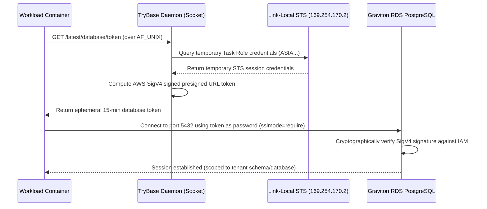

# Passwordless RDS IAM Authentication

> [!NOTE]
> TryBase supports AWS IAM Database Authentication for custom autonomous agents and backend services, allowing workloads to authenticate to PostgreSQL using short-lived (15-minute TTL) cryptographic tokens instead of permanent passwords.

---

## 1. How It Works

AWS IAM Database Authentication eliminates the need to distribute static database passwords to custom workloads:



---

## 2. Verified Infrastructure Controls

To make IAM database authentication functional and secure, TryBase configures three distinct infrastructure layers:

1. **RDS Cluster Configuration (`terraform/rds.tf`)**:
   - `iam_database_authentication_enabled = true` on the Graviton RDS cluster.
2. **PostgreSQL Role Configuration (`lambda/create-schema/main.py`)**:
   - Creates a scoped tenant database user (`usr_<tenant>`) and assigns the PostgreSQL IAM role:
     ```sql
     CREATE USER "usr_tenant" WITH LOGIN;
     GRANT rds_iam TO "usr_tenant";
     GRANT USAGE, CREATE ON SCHEMA "schema_tenant" TO "usr_tenant";
     ```
3. **IAM Task Role Policy (`terraform/modules/generic-workload/main.tf`)**:
   - Grants the container's dedicated Task Role permission to execute `rds-db:connect`:
     ```hcl
     statement {
       actions   = ["rds-db:connect"]
       resources = ["arn:aws:rds-db:${var.aws_region}:${var.aws_account_id}:dbuser:${var.rds_resource_id}/${var.rds_db_user}"]
     }
     ```

---

## 3. Two Token Retrieval Mechanisms

### Option A: Querying the In-Task TryBase Daemon (`AF_UNIX`)
Applications without an AWS SDK can query the TryBase sidecar daemon over the local Unix domain socket:

```bash
# Handshake with daemon
TOKEN=$(curl -s -X PUT http://localhost/latest/api/token --unix-socket /var/run/trybase/secrets.sock)

# Fetch signed 15-minute connection token
curl -s -H "X-TryBase-Token: $TOKEN" http://localhost/latest/database/token --unix-socket /var/run/trybase/secrets.sock
```

The daemon reads task credentials from `169.254.170.2`, performs AWS Signature Version 4 (SigV4) calculation for `rds-db:connect`, and returns the connection payload.

### Option B: Native AWS SDK in Agents (Python / Node.js)
Workloads that already include the AWS SDK (such as Bedrock agents or Python services) can generate the token directly in application code:

```python
import os
import boto3
import psycopg2

rds_client = boto3.client("rds", region_name="eu-west-2")

# Generate signed IAM authentication token valid for 15 minutes
auth_token = rds_client.generate_db_auth_token(
    DBHostname=os.environ["DB_HOST"],
    Port=5432,
    DBUsername=os.environ["DB_USER"],
    Region="eu-west-2"
)

# Connect to PostgreSQL using token as password
conn = psycopg2.connect(
    host=os.environ["DB_HOST"],
    port=5432,
    database=os.environ["DB_NAME"],
    user=os.environ["DB_USER"],
    password=auth_token,
    sslmode="require"
)
```

---

## 4. Operational Boundaries & Workload Compatibility

* **Custom Agents & Backends**: OpenClaw, Python/Django, FastAPI, and Laravel can leverage IAM database authentication directly or via the TryBase daemon.
* **Connection Handshake Token**: The 15-minute token is a connection-establishment credential. Active connections remain established beyond 15 minutes, but connection pools must regenerate a fresh token when reconnecting.
* **Third-Party Packaged Software (n8n, Dify)**: Standard upstream distributions like n8n and Dify do not include IAM token refresh plugins. These workloads continue to use dedicated credentials managed securely in **AWS Secrets Manager**.

---

[Next: Scoped Tenant Database Isolation →](./database-isolation.md)
