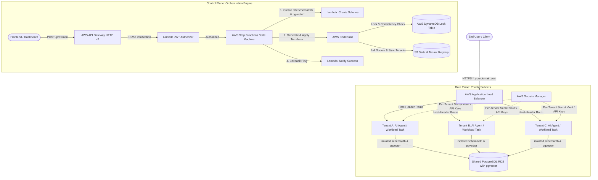

<div align="center">

<p align="center">
  
</p>

### The Open-Source Virtual Single-Tenancy Cloud Engine for AI Fleets & Full-Stack Apps

[](https://opensource.org/licenses/Apache-2.0)
[](docs/prologue/virtual-single-tenancy.md)
[](docs/security/unix-sockets.md)
[](packages/trybase-mcp/README.md)
[](https://aws.amazon.com)
[](#-schema--database-isolation-with-pgvector)
[](CONTRIBUTING.md)

**One Organization. One Private VPC. Your Entire Interconnected AI Stack.**  
Deploy `n8n` (workflow glue), `Dify` (knowledge & prompt studio), `OpenClaw / Bedrock Agents` (autonomous code runner), and full-stack backends (`Laravel`, `Django`, `Go`, `Node`) simultaneously—with true Firecracker microVM compute isolation, isolated PostgreSQL schemas, and zero plaintext `.env` files on production disk.

[📚 Read Full Documentation](docs/README.md) • [The Hook: Why TryBase?](#-why-trybase) • [Virtual Single-Tenancy](#-the-two-core-principles) • [Architecture](#-architecture) • [TryBase MCP](#-model-context-protocol-mcp-server) • [Developer CLI](#-trybase-developer-cli) • [Quickstart](#-quickstart-guide)

---

</div>

## 💡 Why TryBase?

Building an AI agent or microservice locally in Docker is simple (`docker run my-agent:latest`). But the moment a company or agency needs to run an **interconnected AI factory** across multiple clients or environments:
- **Commercial SaaS Platforms** (n8n Cloud + Dify Cloud + Managed Agents) charge **$250–$500+/month** across 3 different dashboards, destroying agency margins.
- **Single VPS Tools (Coolify, Docker Compose)** run everything on one server with a single point of failure and dump plaintext `.env` secrets on disk where rogue tools or supply-chain packages can read `/proc/<pid>/environ`.
- **Kubernetes (EKS)** requires a dedicated SRE team, complex ingress controllers, and a minimum **$150–$250/month baseline fee** before running a single container.
- **Separate Cloud VMs & Databases** create massive infrastructure bloat, complex VPC peering, and crippling AWS bills.

**TryBase solves this with Virtual Single-Tenancy + The Anti-Leak Standard:**  
Developers write simple single-tenant code without polluting their database with `tenant_id` columns. TryBase orchestrates dedicated **AWS ECS Firecracker MicroVMs**, dedicated PostgreSQL schemas (`schema_<tenant>`), and secret delivery over Linux **Unix Domain Sockets (`AF_UNIX`)** on shared AWS infrastructure (~$35–$65/mo baseline instead of $5,000/mo).

| Feature | Single VPS (Coolify / Compose) | Managed AI SaaS | Kubernetes (EKS) | TryBase Engine |
| :--- | :---: | :---: | :---: | :---: |
| **Compute Isolation** | ❌ Shared Host Process | ✅ Isolated | ⚠️ Shared Node Kernel | ✅ **Dedicated Firecracker MicroVM** |
| **Secrets Security** | ❌ Plaintext `.env` on disk | ⚠️ Provider Cloud | ⚠️ Insecure ConfigMaps | ✅ **The Anti-Leak Standard (`AF_UNIX` IPC)** |
| **Multi-Workload AI Stack** | ⚠️ Complex manual stitching | ❌ Disparate SaaS bills | ⚠️ High YAML toil | ✅ **1-Click Fleet (`n8n` + `dify` + `agent`)** |
| **Database & Vector Memory** | ❌ Shared Tables / Unmanaged | ✅ Isolated | ❌ DIY Pods | ✅ **Dedicated RDS Schema + `pgvector`** |
| **Subdomain Routing** | ⚠️ Traefik / Nginx on VPS | ✅ Automated | ⚠️ Ingress-NGINX | ✅ **Host-Header ALB with ACM Wildcard TLS** |
| **AI Agent Control (MCP)** | ❌ None | ❌ Proprietary UI | ❌ Complex Ops | ✅ **Native MCP for Claude & Cursor** |
| **Base Platform Cost** | ~$20/mo (No fault isolation) | ~$250–$500/mo | ~$150–$250/mo | **~$35–$65/mo (Fleet-wide)** |
| **Cost for 20 Tenants** | ~$60/mo (Single crash takes all) | ~$2,000–$5,000/mo | ~$350+/mo | **~$120–$140/mo (Full microVM isolation)** |

---

## 🏗️ Architecture



### 1. Dedicated MicroVM Compute (ECS Fargate)
Every tenant receives their own dedicated AWS Fargate task running their containerized AI agent, worker, or workflow engine. Tasks run inside private subnets without public IPs. If one tenant runs a heavy loop or crashes, no other tenant is impacted.

### 2. Schema & Database Isolation with `pgvector` (RDS PostgreSQL)
Rather than paying for 20 separate database instances, TryBase uses a shared Graviton RDS PostgreSQL cluster with **dual-mode isolation**:
- **Schema-per-tenant** (`CREATE SCHEMA tenant_slug`): Ultra-lightweight for standard microservices and n8n.
- **Database-per-tenant** (`CREATE DATABASE db_tenant_slug`): Complete catalog isolation for frameworks like Dify.
Both modes automatically enable the **`vector` extension (`pgvector`)**, giving every tenant their own isolated vector memory and embeddings index at **$0 extra infrastructure cost**.

### 3. Dynamic Subdomain Routing (Application Load Balancer)
A shared ALB handles TLS termination via AWS Certificate Manager (ACM). When a container is provisioned, CodeBuild attaches a listener rule matching the tenant's host header (e.g. `client-a.<domain>`) forwarding directly to that tenant's target group.

### 4. Zero-Knowledge Credential Security
TryBase provisions a dedicated AES-256 secret vault per tenant in AWS Secrets Manager for encryption keys, tool credentials, and LLM API keys (OpenAI, Anthropic, Bedrock). Even on a shared database, one tenant cannot decrypt another tenant's credentials.

### 5. Serverless Provisioning Pipeline
- **API Gateway**: REST endpoint with custom ES256 JWT authorizer for Supabase / custom auth tokens.
- **Step Functions**: 4-step state machine orchestrating database setup, dynamic CodeBuild Terraform application, and callback notification.
- **S3 State & Tenant Registry**: CodeBuild automatically syncs `tenant_<slug>.tf` configurations, stores the Terraform remote state (`shared/terraform.tfstate`), and pulls the infrastructure source archive (`source/infra.zip`).
- **DynamoDB State Lock Table**: Manages distributed state locks and MD5 cryptographic integrity for Terraform (`n8n-hosting-saas-tf-locks`). Prevents race conditions and state corruption when multiple tenants are provisioned concurrently by CodeBuild or when local administrators run Terraform.

---

## 🛡️ The Two Core Principles

### 1. Virtual Single-Tenancy (The Death of `tenant_id`)
In traditional multi-tenancy, developers spend months adding `tenant_id` columns to every database table, wrapping every ORM query in scoping middleware, and praying a junior developer doesn't write `SELECT * FROM users` without a `WHERE tenant_id = ?` clause. One bug exposes every client's private data.

**TryBase introduces Virtual Single-Tenancy:**
- **Single-Tenant Simplicity**: You write code as if only one company exists in the world.
- **Physical Isolation**: Each workload runs inside a dedicated **AWS Firecracker MicroVM** (ECS Fargate) with zero shared memory and isolated PostgreSQL schemas (`schema_<tenant>`) on a high-density Graviton RDS cluster.
- **Micro-Economics**: You get the rock-solid isolation of dedicated hardware with the cost efficiency of shared infrastructure (~$35–$65/mo base for the entire cluster).

---

### 2. The Anti-Leak Standard
Environment variables (`process.env`) and `.env` files are the #1 vulnerability in modern cloud computing. A single malicious npm/pip dependency, debug endpoint, or server error log dumps raw API keys to external attackers.

**TryBase enforces the Anti-Leak Standard:**
- **Zero Plaintext Files on Disk**: Production tasks have no `.env` files.
- **Sanitized `process.env`**: Container environments are scrubbed clean of production credentials.
- **Kernel-Level Identity Verification**: Secrets are delivered in-memory via an in-task Linux Unix Domain Socket (`/var/run/trybase/secrets.sock`).
- **`SO_PEERCRED` & `/proc/<pid>/exe` Binary Inspection**: The TryBase Rust sidecar daemon queries the Linux kernel to verify caller PID, UID, and binary authenticity before vending secrets.
- **Ephemeral STS & RDS IAM Tokens**: Database passwords expire every 15 minutes and rotate silently in memory.

---

## 🤖 Model Context Protocol (MCP) Server (`@trybase/mcp`)

TryBase includes a first-class **Anthropic Model Context Protocol (MCP)** server, turning **Claude Desktop**, **Cursor**, or an autonomous **Bedrock Agent** into your fleet's Site Reliability Engineer (SRE).

Plugging `@trybase/mcp` into your agent gives it 10 native cloud primitives:
1. `trybase_list_workloads`: Real-time inventory of all workloads, memory pressure, and p95 latencies.
2. `trybase_deploy_fleet`: Deploy multi-workload fleets (`n8n` + `dify` + `agent`) from declarative manifests.
3. `trybase_deploy_workload`: Spin up isolated microVM containers with dedicated DB schemas.
4. `trybase_exec_command`: Execute interactive commands inside isolated microVM sandboxes.
5. `trybase_get_container_logs`: Stream and filter stdout/stderr CloudWatch logs.
6. `trybase_scale_workload`: Dynamically scale CPU & RAM with zero-downtime rolling updates.
7. `trybase_restart_workload`: Force redeployment and verify container healthchecks.
8. `trybase_create_backup`: On-demand logical S3 database backups (`pg_dump`).
9. `trybase_set_secrets`: Push encrypted credentials directly into AWS Secrets Manager vaults.
10. `trybase_run_migration`: Run schema migrations in isolated ephemeral task containers.

```json
// Add to claude_desktop_config.json or .cursor/mcp.json
{
  "mcpServers": {
    "trybase": {
      "command": "npx",
      "args": ["-y", "@trybase/mcp@latest"],
      "env": {
        "TRYBASE_API_KEY": "tb_org_live_...",
        "AWS_REGION": "eu-west-2"
      }
    }
  }
}
```

---

## ⚡ TryBase Developer CLI (`@trybase/cli`)

Never paste API keys or database credentials into web dashboard forms. The TryBase CLI closes the developer workflow loop:

```bash
# 1. Install CLI
npm install -g @trybase/cli

# 2. Push production secrets directly to AWS Secrets Manager (Zero disk exposure)
trybase env push .env.production --workload workflow

# 3. Deploy an entire multi-workload AI fleet
trybase fleet deploy trybase.fleet.yml

# 4. Inspect fleet status and container health
trybase status
```

### Declarative Fleet Manifest (`trybase.fleet.yml`)
```yaml
organization: acme-ai
workloads:
  - name: workflow
    archetype: n8n
    subdomain: n8n.acme.trybase.dev
    cpu: 1024
    memory: 2048

  - name: knowledge
    archetype: dify
    subdomain: dify.acme.trybase.dev
    cpu: 1024
    memory: 2048

  - name: runner
    archetype: openclaw
    subdomain: agent.acme.trybase.dev
    cpu: 1024
    memory: 2048
```

## 💰 Cost Breakdown

TryBase is designed to be lean. Below is an estimated real-world AWS cost breakdown (using standard pricing in `us-east-1` / `eu-west-2`):

### Shared Platform Base (Fixed)
| Resource | Spec | Est. Monthly Cost |
| :--- | :--- | :--- |
| **AWS RDS PostgreSQL** | `db.t4g.micro` (ARM64, 20GB GP2) | ~$15.00 |
| **Application Load Balancer** | 1 ALB with SSL termination | ~$18.00–$22.00 |
| **VPC Endpoints & Networking** | S3 Gateway + Secrets Manager Endpoints | ~$15.00–$25.00 |
| **API Gateway & Step Functions** | Serverless (Pay-per-request) | < $1.00 |
| **DynamoDB (State Locking)** | On-Demand (`PAY_PER_REQUEST`, state locks only) | $0.00 |
| **Total Base Cost** | **Shared Cluster Foundation** | **~$50–$65 / month** |

### Per-Tenant Cost (Variable)
| Resource | Allocation | Est. Monthly Cost |
| :--- | :--- | :--- |
| **Fargate Task** | 0.5 vCPU / 1.0 GB RAM (24/7 runtime) | ~$3.50–$4.50 / month |
| **Secrets Manager** | 1 Encryption Key secret | ~$0.40 / month |
| **Total Per Active Tenant** | | **~$4.00–$5.00 / month** |

> 💡 **Fleet Economics**: 20 fully isolated, dedicated enterprise n8n tenants cost approximately **~$130–$150/month total** on AWS, compared to **$1,000+/month** on managed SaaS platforms.

---

## ⚖️ Why TryBase Instead of Kubernetes (EKS)?

A common question from cloud architects is: *"Why not deploy this on Kubernetes (EKS) with Helm?"*

While Kubernetes is powerful for microservice meshes, running multi-tenant isolated workloads like n8n on Kubernetes introduces substantial cost, complexity, and security trade-offs:

| Dimension | Kubernetes (AWS EKS) | TryBase (AWS ECS Fargate) |
| :--- | :--- | :--- |
| **Minimum Base Cost** | **~$150–$250 / month** ($73/mo EKS cluster fee + redundant EC2 worker nodes) | **~$50 / month** (ALB + Graviton RDS; Fargate has zero cluster fee) |
| **Maintenance Overhead** | **High** (Mandatory yearly k8s version upgrades, deprecated APIs, node patching, CNI upgrades, Helm charts) | **Zero** (Serverless AWS managed runtime; no nodes, no OS, no cluster to patch) |
| **Container Isolation** | **Shared Linux Kernel** (Pods share nodes; vulnerable to noisy neighbors and kernel exploits) | **Firecracker MicroVM** (Every tenant task runs in a dedicated hardware hypervisor) |
| **DevOps Footprint** | **Requires Dedicated SRE** (Ingress-NGINX, Cert-Manager, Karpenter, Pod Disruption Budgets) | **Developer-Friendly** (2 CLI commands: `make control-plane` and `make infra`) |
| **Database Multi-Tenancy** | **Unsolved** (Requires custom operators or 20 separate unmanaged Postgres pods) | **Built-in** (Automated Postgres schema engine + AWS Secrets Manager) |

### Key Architectural Rationale

1. **Zero "Cluster Tax"**: In AWS, just keeping an EKS control plane alive costs **$73.00/month** before deploying a single pod. Add two worker nodes for high availability, and your minimum baseline is ~$150+/month even with zero users. TryBase uses **ECS Fargate**, which has **$0.00 cluster fees**—you only pay for active container seconds.
2. **True Hardware Isolation (MicroVMs)**: In standard Kubernetes, pods share the worker node's host kernel. If Tenant A runs a runaway workflow or encounters a memory leak, it can starve or crash the node, impacting Tenant B. With AWS Fargate, each tenant container runs inside its own **AWS Firecracker MicroVM** with hardware-level boundary isolation.
3. **No Kubernetes Upgrade Treadmill**: Kubernetes forces major version upgrades every ~12 months, which routinely break Ingress resources, CRDs, and CNI plugins. TryBase relies entirely on managed serverless building blocks (Fargate, Step Functions, RDS), meaning zero node management, zero AMI patching, and zero operational toil.
4. **The Database Problem**: Kubernetes only orchestrates containers—it does not solve data isolation. TryBase provides the automated database schema provisioning pipeline (`CREATE SCHEMA tenant_slug`) on a single high-performance Graviton RDS instance, achieving strict isolation at 90% lower cost.

---

## 🚀 Quickstart Guide

### Prerequisites
- [AWS CLI v2](https://docs.aws.amazon.com/cli/latest/userguide/install-cliv2.html) installed and configured (`aws configure`).
- [Terraform](https://developer.hashicorp.com/terraform/downloads) >= 1.8.0.
- [Docker](https://www.docker.com/) running locally (for initial Lambda image push).
- A domain with a **Wildcard SSL Certificate** in AWS Certificate Manager (e.g. `*.n8n.yourdomain.com`).

## ⚡ Deploy in 2 Commands

TryBase is engineered for maximum developer velocity. Bootstrapping the entire multi-tenant platform (Supabase Control Plane + AWS Fleet Infrastructure) takes just **2 CLI commands**:

```bash
git clone https://github.com/your-username/trybase.git
cd trybase
```

### 1️⃣ Command 1: Deploy the Control Plane (Supabase)
```bash
./deploy-control-plane.sh
# or: make control-plane
```
**What this does automatically:**
- Links to your Supabase project (prompts for your Project Ref if needed).
- Pushes database migrations (creates `workspaces` table with Row-Level Security).
- Deploys the 3 Edge Functions (`on-provision-success`, `verify-checkout`, `create-portal-session`).
- Automatically updates `terraform/terraform.tfvars` with your Supabase URL and settings.

---

### 2️⃣ Command 2: Deploy the Fleet Infrastructure (AWS)
```bash
./deploy-infra.sh
# or: make infra
```
**What this does automatically:**
- Verifies your AWS credentials and Terraform installation.
- Initializes Terraform and provisions the shared VPC, private subnets, Graviton RDS PostgreSQL database, Application Load Balancer, Step Functions state machine, and CodeBuild executors.
- Outputs the **ALB DNS Name** and **API Gateway Provisioning Endpoint**.

---

### 3️⃣ Point Your Wildcard Domain (Final Step)
Once `./deploy-infra.sh` finishes, it outputs `alb_dns_name`:
```text
alb_dns_name = "n8n-hosting-shared-alb-123456789.eu-west-2.elb.amazonaws.com"
```
In your DNS provider (Hostinger, Cloudflare, GoDaddy, Namecheap):
Add a single **Wildcard CNAME**:
| Record Type | Host / Name | Target / Points To |
| :--- | :--- | :--- |
| **CNAME** | `*.n8n` *(or `*` if using apex)* | `<alb_dns_name>` |

---

### 4️⃣ Launch the Web Dashboard (UI)
```bash
make web
```
Spins up the integrated React/Vite dashboard locally with interactive provisioning, real-time terminal logs, and multi-engine selection (n8n Automation & Dify AI Studio).

🎉 **That's it!** Your entire platform is live. You can immediately provision tenants via the UI, API, or GitOps.

---

## 👥 Provisioning Tenants

You can provision tenants in two ways: **Automated via API** or **Declarative via GitOps**.

### Option A: Automated via API (Recommended for Platforms & Dashboards)
Send an authenticated `POST` request to your API Gateway endpoint:

```bash
curl -X POST "https://<API_GATEWAY_URL>/provision" \
  -H "Authorization: Bearer <JWT_TOKEN>" \
  -H "Content-Type: application/json" \
  -d '{
    "tenant_id": "acme-corp",
    "subdomain": "acme",
    "rule_priority": 100
  }'
```

**What happens behind the scenes:**
1. API Gateway validates the JWT with the ES256 Lambda Authorizer.
2. Step Functions triggers the `n8n-tenant-create-schema` Lambda to create Postgres schema `acme_corp`.
3. CodeBuild pulls the Terraform source archive from S3, generates `tenant_acme-corp.tf`, and runs `terraform apply -target=module.acme_corp`.
4. The ALB automatically begins routing `https://acme.n8n.yourdomain.com` to the new Fargate container.

---

### Option B: Declarative via GitOps
If you prefer managing tenants statically in Git without the API:

1. Copy the tenant example file:
   ```bash
   cp tenant_example.tf.example tenant_acme.tf
   ```
2. Edit `tenant_acme.tf` with your tenant slug and unique ALB priority:
   ```hcl
   module "acme" {
     source    = "./modules/tenant"
     tenant_id = "acme"
     subdomain = "acme"
     db_schema = "acme"
     
     alb_listener_rule_priority = 100
     # (Shared variables mapped from shared infrastructure)
   }
   ```
3. Apply the tenant:
   ```bash
   terraform apply -target=module.acme
   ```

---

## 📦 Run Any Containerized AI Agent or Workload

TryBase is **100% container-agnostic**. While we provide pre-configured templates for common engines like Dify and n8n, the core superpower is the **Generic Container Module** (`modules/generic-workload`):

> **Bring any Docker container** — your custom Python CrewAI agent, AutoGen bot, LangChain pipeline, FastAPI microservice, or open-source tool — and TryBase gives it dedicated microVM compute, dynamic wildcard SSL subdomains, keyless Bedrock IAM, and native vector memory in seconds.

### Example: Deploying a Custom Python AI Agent (Keyless Bedrock + pgvector)

```hcl
module "finance_agent" {
  source = "./modules/generic-workload"

  service_name      = "finance-agent"
  subdomain         = "finance-bot"
  container_image   = "ghcr.io/my-org/crewai-finance-agent:v1.0"
  container_port    = 8000
  health_check_path = "/health"

  # Attach dedicated per-tenant IAM Task Role with keyless Bedrock access
  enable_bedrock    = true

  environment_variables = {
    AWS_DEFAULT_REGION = "eu-west-2"
    DATABASE_URL       = "postgresql://user:pass@${aws_db_instance.rds.endpoint}/postgres?sslmode=require"
    AGENT_ENV          = "production"
    # ZERO API KEYS NEEDED! Boto3 automatically retrieves 60m STS tokens from link-local Fargate metadata
  }

  # Bind to TryBase shared infrastructure
  vpc_id                     = module.vpc.vpc_id
  private_subnet_ids         = module.vpc.private_subnets
  ecs_cluster_name           = aws_ecs_cluster.main.name
  alb_listener_arn           = aws_lb_listener.https.arn
  alb_security_group_id      = aws_security_group.alb.id
  alb_listener_rule_priority = 150
  domain_name                = var.base_domain
}
```

### 🛡️ How to Write a Keyless Bedrock Agent Container

Unlike traditional hosting platforms that require storing raw `OPENAI_API_KEY` or `AWS_SECRET_ACCESS_KEY` in environment variables (which get stolen during supply chain compromises or container breaches), TryBase containers authenticate **keylessly**:

```python
# agent.py - Zero hardcoded API keys
import json, boto3
from fastapi import FastAPI

app = FastAPI(title="Bedrock Financial Agent")

# ZERO CREDENTIALS PASSED:
# Boto3 queries the ECS link-local metadata agent (http://169.254.170.2).
# AWS STS vends a 60-minute ephemeral session token and silently rotates it in memory.
bedrock = boto3.client("bedrock-runtime", region_name="eu-west-2")

@app.post("/chat")
def chat(prompt: str):
    body = json.dumps({
        "anthropic_version": "bedrock-2023-05-31",
        "max_tokens": 1024,
        "messages": [{"role": "user", "content": prompt}]
    })
    
    # Invokes Claude 3.5 Sonnet under this tenant's dedicated IAM Task Role
    response = bedrock.invoke_model(
        modelId="anthropic.claude-3-5-sonnet-20240620-v1:0",
        body=body
    )
    result = json.loads(response["body"].read())
    return {"reply": result["content"][0]["text"]}
```

### Architecture Comparison: Status Quo vs. TryBase

| Architectural Vector | Fragile Status Quo (PaaS / DIY) | The TryBase Hyperscaler Standard |
| :--- | :--- | :--- |
| **API Credentials** | Permanent keys (`AKIA...` / `sk-...`) in `.env` files or databases. | **Zero secrets stored.** In-memory STS tokens auto-rotated every 60 min. |
| **Supply Chain Exposure** | Malicious packages dump environment variables to external servers. | **No static keys exist** in the environment to steal. |
| **Multi-Tenant Blast Radius** | Shared API keys. One compromised container drains everyone's quotas. | **Per-tenant IAM Task Roles.** Tenant A physically cannot call Tenant B's models. |
| **Network Attack Surface** | Containers assigned public IPv4 addresses reachable by botnets. | **100% Private VPC (0 Public IPs).** ALB terminates TLS; tasks sit in private subnets. |

**Instant Results:**
- 🛡️ **Private MicroVM**: Runs in its own AWS Firecracker MicroVM on Fargate — no shared memory, no host kernel leaks.
- 🌐 **Instant HTTPS Subdomain**: Live immediately at `https://finance-bot.<yourdomain.com>` with automatic ACM wildcard TLS.
- 🧠 **Native Vector Memory**: Connected directly to Graviton RDS with native `pgvector` enabled for semantic search and RAG.

### Pre-Configured Workload Templates
TryBase includes battle-tested starter configurations:
- **Custom Containers** (`modules/generic-workload`): Any Docker image from Docker Hub, ECR, or GitHub Packages with keyless Bedrock IAM.
- **Dify AI Studio Adapter** (`terraform/tenant_dify.tf.example`): Visual agent studio with dedicated database & `pgvector` RAG.
- **n8n Workflow Automation** (`modules/tenant`): Schema-isolated workflow automation engine with AES-256 encrypted credential vaults.

---

## 🛠️ Repository Structure

```text
trybase/
├── terraform/
│   ├── main.tf                    # Provider configuration & data sources
│   ├── variables.tf               # Configurable parameters & defaults
│   ├── terraform.tfvars.example   # Example configuration template
│   ├── outputs.tf                 # ALB DNS, API Gateway URL, Step Function ARNs
│   ├── vpc.tf                     # 3-tier VPC with public/private subnets
│   ├── alb.tf                     # Application Load Balancer & HTTPS redirect
│   ├── rds.tf                     # Shared Graviton RDS PostgreSQL instance
│   ├── ecs.tf                     # ECS Cluster definition
│   ├── apigateway.tf              # HTTP v2 API & CORS configuration
│   ├── authorizer.tf              # ES256 Supabase JWT Lambda Authorizer
│   ├── stepfunctions.tf           # Orchestration state machine
│   ├── codebuild.tf               # Terraform executor for dynamic tenant provisioning
│   ├── bastion.tf                 # Secure jump host for private database administration
│   ├── tenant_example.tf.example  # Declarative GitOps tenant template
│   └── modules/
│       └── tenant/                # Reusable tenant module (Fargate task, target group, rules)
├── lambda/
│   ├── authorizer/                # Lightweight Node.js ES256 JWT verifier
│   └── create-schema/             # Python RDS schema provisioning container
├── sync-tenants.sh                # Synchronizes dynamic tenant configs from S3 to local Git
├── cleanup-enis.sh                # Helper script to clean up orphaned Lambda ENIs
├── BOOTSTRAP.md                   # Operational guide & bootstrap gotchas
├── ARCHITECTURE.md                # Comprehensive technical specification
└── LICENSE                        # Apache 2.0 License
```

---

## 🤝 Operational Workflows

### Keeping Local State in Sync with Cloud Tenants
When tenants are provisioned via API, CodeBuild saves their configuration files in the S3 state bucket. Before running local Terraform commands, always sync your local directory:
```bash
./sync-tenants.sh
```

### Accessing the Database via Bastion
To inspect tenant schemas or debug workflows:
```bash
# 1. Retrieve master credentials
aws secretsmanager get-secret-value --secret-id $(terraform -chdir=terraform output -raw db_credentials_secret_arn) --query SecretString --output text

# 2. Connect through the Bastion jump host
ssh -i ~/.ssh/your-key.pem ec2-user@<BASTION_IP>

# 3. Inside the bastion, connect to PostgreSQL
PGPASSWORD='<PASSWORD>' PGSSLMODE=require psql -h <DB_HOSTNAME> -U n8nmaster -d postgres
```

### Forecasting Cloud Costs with Infracost
TryBase integrates with [Infracost](https://www.infracost.io/) (Apache 2.0) to forecast monthly AWS and multi-cloud fleet expenses before applying changes:
```bash
make cost
```

---

## 🗺️ Roadmap: The Universal Container Platform

TryBase is building the ultimate open-source platform for multi-tenant container fleets and AI workloads:

### 1. Workload Orchestration
- [x] **Universal Container Module** (`modules/generic-workload`): Deploy any arbitrary Docker container (custom Python AI agents, CrewAI, AutoGen, microservices) with private Fargate microVM isolation and ALB host routing.
- [x] **Multi-Database & `pgvector` Provisioning**: RDS Lambda dual-mode orchestrator supporting *Schema-per-tenant* (`CREATE SCHEMA`) and *Database-per-tenant* (`CREATE DATABASE`) with native `vector` extension setup.
- [x] **Integrated Web Monorepo (`web/` & `make web`)**: Vite/React dashboard with workload selection, real-time Step Function terminal logs, and customer self-service.
- [x] **Production Starter Adapters**:
  - **n8n Workflow Engine**: Hardened with Postgres schema scoping, unique encryption keys, and Resend SMTP.
  - **Dify AI Studio**: Enterprise multi-agent platform with dedicated database and native `pgvector` RAG (`terraform/tenant_dify.tf.example`).
- [ ] **Langflow Adapter**: Visual agent workflow runner.
- [ ] **Custom Container Image Registry**: Direct pull integration with private ECR and Docker Hub secrets.

### 2. Platform & FinOps Capabilities
- [x] **Infracost Integration (`make cost`)**: Forecast exact monthly infrastructure and tenant costs via open-source Infracost.
- [ ] **Container Auto-Idling (Scale-to-Zero)**: Automatically scale down inactive tenant Fargate tasks to 0 and wake on incoming HTTP webhooks (slashing compute bills by up to 80%).
- [ ] **Custom Domain Management**: Allow tenants to bring their own apex domains via CNAME with automated ACM SSL issuance.
- [ ] **Multi-Cloud Adapters**: Google Cloud (Cloud Run + Cloud SQL) and Azure (Container Apps).

---

## 📄 License & Disclaimer

### License
This project is licensed under the **Apache License 2.0** - see the [LICENSE](LICENSE) file for details.

### Disclaimer & n8n Fair-Code Notice
- **TryBase** is an independent, community-driven open-source project and is not affiliated with, endorsed by, or sponsored by n8n GmbH.
- `n8n` is a registered trademark of n8n GmbH.
- n8n software is distributed under its Fair-Code [Sustainable Use License](https://n8n.io/legal/sustainable-use-license). While this repository provides infrastructure code for self-hosting n8n instances, anyone intending to offer n8n as a commercial SaaS service to third parties should consult n8n GmbH regarding their commercial licensing terms.
